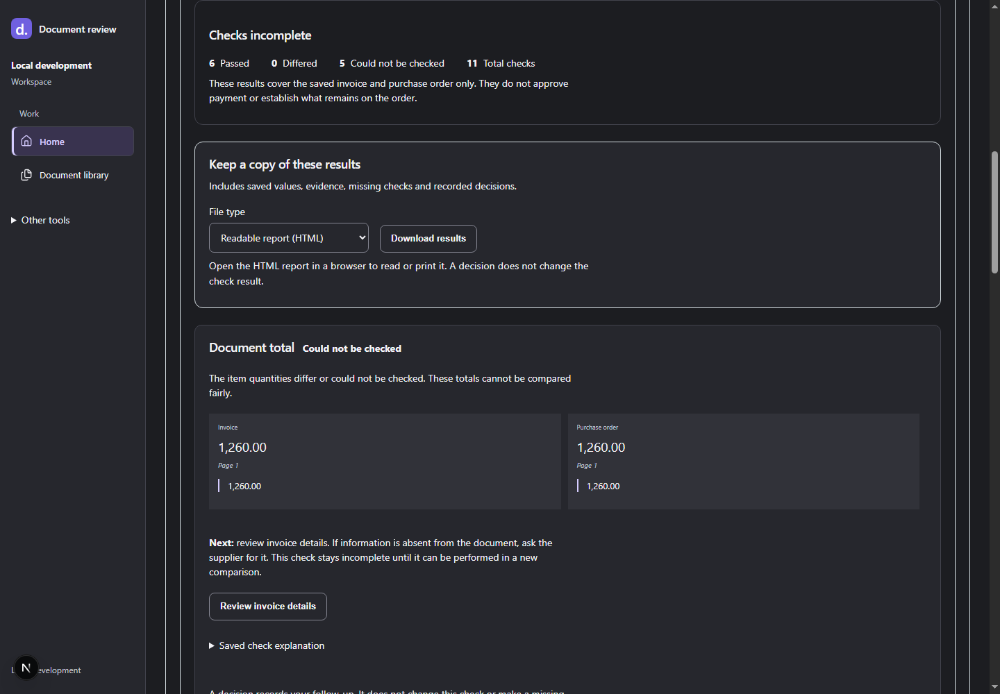

# RandCheck

Invoice and purchase order review. GitHub repository name: `randcheck`.

**Status:** current local-development milestone completed on October 27, 2026.
The owner closed this checkpoint and authorized GitHub upload. Remaining checks
and production limits are explicit in the [acceptance map](docs/testing/local-delivery-acceptance-20261027.md).
The application remains unlicensed.

Check a supplier invoice against its purchase order, with the source evidence
beside the results. The main workflow stays on one page:

**Add invoice + PO → Check details → See results**

1. **Add both files.** Upload PDF, PNG, JPEG or TXT, or choose saved documents.
   One file can wait in the library. A check is created only after both choices
   are saved.
2. **Check details.** Read the extracted values and evidence. Confirm what is
   correct, fix mistakes with a reason, and leave missing facts explicit.
3. **See results.** The backend compares the exact saved review versions. Read
   **Differences found**, **Checks incomplete**, or **All required checks passed**.
   Record decisions and download a readable HTML report or CSV spreadsheet.

Completing a review does not mean the invoice matches. Recording a decision never
turns an unperformed check into a passed check. Later edits do not rewrite earlier
reviews, comparisons or audit records. New checks use AED only; there is no silent
currency conversion. Quotations remain accessible for history but are not part of
new checks. Goods receipts are outside scope.



*Actual local-system screenshot with fictional documents: matching totals still
leave missing item checks incomplete.*

## Run the real local demo

Use **Windows with PowerShell 7, Git and Docker Desktop with Linux containers**. Initial
builds download public dependencies and need several GB of free disk space. No
cloud account, paid AI provider or Microsoft sign-in is needed for this demo.

From the repository root in PowerShell 7:

```powershell
$demo = ./tools/prepare-local-demo.ps1
Set-Location $demo
./tools/local-demo.ps1 up
```

Open <http://127.0.0.1:3308>. Start with
`samples/supplier-invoice/v0.1.0/english-invoice.pdf` and `english-po.pdf` inside
the copy. The [demo guide](docs/local-demo.md) explains the expected incomplete
result, startup, shutdown, health check and guarded reset. The first page visit
can be slow while the development server compiles it.

```powershell
./tools/local-demo.ps1 down   # Stop; keep saved work
./tools/local-demo.ps1 up     # Start again
./tools/local-demo.ps1 reset  # Remove only this disposable demo's data
```

The helper creates an isolated source copy and binds the web/API to loopback
ports 3308/8308. It does not use a retained development database. Reset is for
that disposable copy only. The default application security mode remains Locked;
the demo explicitly uses a clearly labelled Development Staff identity.

For quick design work, **Start preview.cmd** opens the separate
[synthetic UI preview](docs/ui-preview.md). Its simulated results are not backend
or OCR verification. **Stop preview.cmd** stops that preview. The
[advanced developer setup](docs/setup.md) is a separate configuration.

## Other screens and access

- **Document library:** 10 files per page; search filenames, suppliers and printed
  invoice/PO references. Open saved values and evidence without starting a review.
- **Earlier cases and history:** read saved comparisons, evidence and decisions.
- **Ask about documents:** choose completed reviews and ask supported questions.
  Missing or unsupported facts remain unanswered; normal use needs no paid model.
- **Administration:** People & access, Activity history and Document storage.
  Staff handles documents; Admin also manages people and settings. Existing
  accounts require a reviewed role migration—no silent access expansion.

Real organization sign-in and first-Admin provisioning belong to the separate
enterprise setup. The local demo does not create a real Microsoft account or
promote its Staff identity to Admin. See the
[Admin verification and limits](docs/testing/local-language-security-20261027.md).

## Architecture and checks

Next.js provides the workspace. ASP.NET Core owns authorization, business rules,
versions and audit. Its Application layer uses repository interfaces implemented
in Infrastructure with EF Core/PostgreSQL. A durable .NET worker calls the private
Python/FastAPI extractor; original values, page evidence and human decisions stay
separate. See the [architecture](docs/architecture.md) and [contributor guide](AGENTS.md).

The [workflow guide](docs/workflow-review.md) explains the screens and decisions
in plain language. Fresh dated evidence is separate from older receipts:

| Area | Current evidence |
| --- | --- |
| Actual upload, extraction, review, comparison, decision, retry and reopen | [Fresh local journey](docs/testing/local-journey-20261027.md) |
| Coherent HTML/CSV downloads and preserved saved versions | [Results export](docs/testing/results-export-20261027.md) |
| Real local Admin API, permissions and bounded Arabic/scanned checks | [Language and security](docs/testing/local-language-security-20261027.md) |
| Clean source, complete test discovery, restart and CI progress | [Delivery verification](docs/testing/clean-source-delivery-20261027.md) |

Use the [CI guide](docs/testing/ci.md) for containerized checks and the
[Python runtime guide](docs/testing/python-runtimes.md) for its separate test
groups. The [completion ledger](docs/tasks/local-completion-20261027.md) records
what is implemented, verified and still open. No historical test total below is
a claim that the same checks ran today. The
[local acceptance map](docs/testing/local-delivery-acceptance-20261027.md) connects
each supported claim to its evidence and remaining limits.

## Limits and delivery scope

This is a supported local portfolio project, not a production deployment.
Extraction is bounded: sample success does not prove accuracy on every supplier
layout. Arabic/mixed-language OCR remains experimental; English digits are used,
and missing marks or uncertain document types require review. Incomplete checks
must stay incomplete. Optional paid semantic experiments remain disabled and
separate from the normal workflow.

Local offline-token tests do not establish real Entra sign-in, production scanner
operation, TLS/key delivery, cloud hosting or production recovery. Hosted CI and
publication also need their own evidence and authorization.

**Software license:** intentionally unlicensed until the owner decides, confirmed
October 27, 2026. Sample-specific and third-party licenses remain separate. See
the [publication review](docs/security/publication-review.md) and
[third-party notices](docs/security/third-party-notices.md) for provenance,
terms and the source inventory. Nothing has been published by this completion
work.


<details>
<summary>Historical verification checkpoints</summary>

These dated receipts preserve earlier implementation and acceptance evidence.
Statements about outstanding work and test totals apply to those checkpoints.

**Phase 6 local security complete — September 16, 2026:** [Acceptance evidence](docs/evidence/phase-6/P6-local-acceptance-20260916.md) covers membership, roles, tenant isolation, audit, protected sources and local recovery. The default remains Locked. Real Entra and production infrastructure remain unverified.

**Phase 8 local demo and CI:** the [disposable demo guide](docs/local-demo.md) provides current-source isolation, loopback startup, migrations, shutdown and guarded reset. See [verification and screenshots](docs/evidence/phase-8/P8-local-demo-20260916.md) for the English invoice journey. Local CI passes 1,780 tests plus builds, lint, migrations and scoped dependency audits; see the [CI guide](docs/testing/ci.md) and [verification report](docs/evidence/phase-8/P8-ci-local-20260916.md). Phase 7 Arabic support, hosted CI proof and publication review remain pending.

**September 19 priority follow-up:** two fresh demo trials pass upload, extraction,
review, restart persistence and safe reset. The updated source passes 1,785 tests
and its builds; its combined run was interrupted during dependency audits, so it
is not a new all-green CI result. See the [follow-up report](docs/evidence/phase-8/P8-priority-followup-20260917.md).

**September 21 reconciliation walkthrough:** the existing Phase 4 feature is now
demonstrated with three synthetic documents, nine expected discrepancies and a
retained reviewer decision. See the [walkthrough and screenshots](docs/evidence/phase-8/P8-reconciliation-demo-20260921.md).

**September 11, 2026:** [Phase 5 development acceptance](docs/evidence/phase-5/P5-development-acceptance-20260911.md) is complete for bounded reviewed answers, case selection and prepared-query semantic evidence search. Full regression and snapshots are recorded; optional model answers remain disabled. Earlier implementation bullets below are historical checkpoints.

### Earlier foundation checkpoints

- Upload PDF, PNG, JPEG, or text documents (10 MB limit)
- ASP.NET modular monolith with Domain, Application, Infrastructure, and API boundaries
- EF Core Code First model with verified Npgsql migrations
- Tenant-ready document, extraction-run, evidence, and review-history schema
- Verified mock and local native/OCR providers behind the private Python provider interface
- Explicit API DTOs preserving the document-review UI contract
- Append-only human review with correction, confirmation, addition, clearing, completion, reload, and ETag concurrency
- Next.js review UI that keeps machine and effective reviewed values visibly separate
- P5-T06/T08 prompt preflight: complete versioned application prompt, measured-count receipt and reservation/dispatch binding; 362 non-persistence .NET, 40 targeted PostgreSQL and 66 Python cited checks passed. Counter units are synthetic bytes, not verified GPT tokens; paid generation remains disabled ([verification](docs/evidence/phase-5/P5-T06-T08-prompt-preflight-verification.md)).
- P5-T06/T08 internal answer bridge: ledger-to-Python fake-provider integration, committed dispatch protection, synthetic accounting and citation checks without publication; 435 .NET tests and 51 Python cited tests passed. Live generation remains disabled ([verification](docs/evidence/phase-5/P5-T06-T08-answer-bridge-verification.md)).
- P5-T08 durable spending-ledger component: shared USD 8 pilot allowance, atomic reservation/dispatch, duplicate protection and uncertain-cost holds; 411 .NET tests passed including 64 PostgreSQL tests. Paid dispatch remains disconnected ([verification](docs/evidence/phase-5/P5-T08-spending-ledger-verification.md)).
- P5-T08 provider-free checkpoint: 331 passing .NET tests (282 non-persistence and 49 PostgreSQL), 20 web checks, and one real-stack synthetic native-PDF browser flow including quarantine/history denial; semantic answer validation and full Phase 5 acceptance remain outstanding ([verification](docs/evidence/phase-5/P5-T08-security-verification.md)).
- P5-T08 request-boundary increment: 64 KiB cited-body limit, bounded streaming reads, safe JSON failures and rejection-log privacy tests; 307 non-persistence .NET tests passed (25 new API cases). Invoice uploads remain at 10 MiB. PostgreSQL/web results above were not rerun for this increment ([verification](docs/evidence/phase-5/P5-T08-request-boundary-verification.md)).
- P5-T08 workflow-log increment: private-client safe telemetry, generic unexpected errors, and successful/replayed/history/evidence payload privacy checks; 323 non-persistence .NET tests passed. Real database logging and deployed metadata/sink privacy remain unverified ([verification](docs/evidence/phase-5/P5-T08-workflow-log-verification.md)).
- P5-T08 live database-log increment: EF error/exception privacy guard and real PostgreSQL/Python workflow checks; 385 .NET tests passed (333 non-persistence, 52 PostgreSQL). PostgreSQL server logs still contain synthetic error values, so server-log deployment policy remains an open gate ([verification](docs/evidence/phase-5/P5-T08-database-log-verification.md)).
- Python discovery: all 110 tests pass across their declared pinned runtimes, including the local OCR runtime and the intentionally separate Pillow 9.4 fixture-generator runtime
- Deterministic synthetic Phase 2 fixtures with versioned labels, source/license records, and byte-for-byte container reproducibility; these are contract fixtures, not accuracy evidence ([P2-T03 verification](docs/evidence/phase-2/P2-T03-synthetic-fixture-verification.md))
- Zero-warning/error .NET Release build, no pending EF model changes, valid Compose configuration, and passing Next.js tests/lint/build
- Reproduced review result: machine total `1050.00` unchanged, effective total `1155.00`, added `payment_terms = Net 30`, completion and reload persisted
- Phase 3 offline evaluator and comparator with versioned schemas, exact-match/precision/recall/correction/failure/latency/cost metrics, field/layout/scan/provider breakdowns, and configurable regression thresholds
- Phase 4 reconciliation workspace and backend with reviewed-source pinning, immutable runs, explainable header/line rules, configurable tolerances, page evidence, and append-only finding resolutions
- Phase 5 provider-independent cited-question persistence: frozen indexes/corpora, exact page spans, ranked hits, claims, citations, and refusal history; embedding storage and semantic answer orchestration remain outstanding ([P5-T03 verification](docs/evidence/phase-5/P5-T03-persistence-verification.md))
- Phase 5 deterministic Python chunking, ASP.NET source reconstruction, stable citation-span IDs, and disabled-by-default embedding interface; the synthetic pack retains all 46 evidence labels within chunks ([chunking contract](docs/design/phase-5-chunking-contract.md)).
- Phase 5 on-demand index/evidence APIs and English PostgreSQL keyword retrieval: 45/46 labelled evidence items and all evidence for 23/24 answerable questions retrieved in the top five; tiny synthetic corpus only, no generated answers or vector/hybrid comparison ([lexical contract](docs/design/phase-5-lexical-retrieval-contract.md)).
- Phase 5 strict citation-proposal validation and provider-free no-hit question/refusal API. Structural citation checks do not establish semantic claim support, and nonempty evidence does not automatically become an answer ([validation checkpoint](docs/evidence/phase-5/P5-T06-validation-verification.md)).
- Phase 5 `/questions` evidence workspace with completed-review pinning, saved-result reload, visible refusal, and authorized canonical-text highlighting; no generated answers or PDF image viewer ([workspace checkpoint](docs/evidence/phase-5/P5-T07-workspace-verification.md)).
- Versioned synthetic UAE quotation/PO/invoice pack and live-stack acceptance: 3 completed reviews, 9/9 exact expected findings, and a retained reasoned resolution; these are development results, not real-world accuracy claims

### P2-T06 durable workflow

Migration `20260811131151_AddDurableExtractionQueue`, asynchronous `202` upload, PostgreSQL `extraction_jobs`, the .NET worker, authenticated private Python route, scoped storage/cleanup, fencing/cancellation/reprocess primitives, and Activity/Meter hooks are complete. Real local Compose demonstrations reached `Ready` for one synthetic native PDF and one synthetic scanned PDF. See the [P2-T06 verification](docs/evidence/phase-2/P2-T06-queue-worker-verification.md).

### Earlier phase acceptance receipts

The completed Phase 1 result is recorded in the [P1-T08 acceptance verification](docs/evidence/phase-1/P1-T08-acceptance-verification.md), with the earlier database checkpoint preserved in [P1-T04 evidence](docs/evidence/phase-1/P1-T04-database-verification.md). The completed local Phase 2 outcome is recorded in [P2-T08 acceptance verification](docs/evidence/phase-2/P2-T08-acceptance-verification.md), with durable workflow details in [P2-T06 verification](docs/evidence/phase-2/P2-T06-queue-worker-verification.md).

Phase 3 is complete for the approved development-only boundary. The live
Phase 2→Phase 3 bridge, generated UAE benchmark comparison,
review cues, action analytics, and history export are recorded in the
[Phase 3 development acceptance verification](docs/evidence/phase-3/P3-T07-development-acceptance-verification.md).

Phase 4 has passed its technical acceptance gate. The reconciliation workspace,
synthetic procurement truth set, split-runtime regression matrix, and live API
scenario are recorded in the
[Phase 4 acceptance verification](docs/evidence/phase-4/P4-T06-T08-acceptance-verification.md).
The roadmap remains in progress until Rand formally approves phase completion.
All reported UAE-pack metrics are synthetic regression results, not real-world
extraction-accuracy claims.

See the [product specification](docs/product-spec.md), [architecture](docs/architecture.md), and [roadmap](docs/roadmap.md).


</details>
