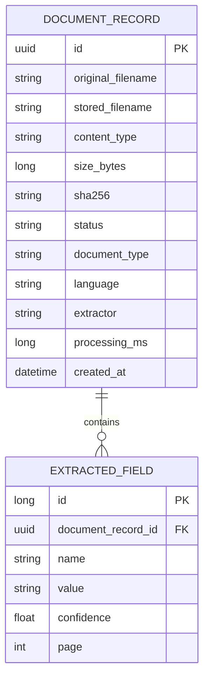
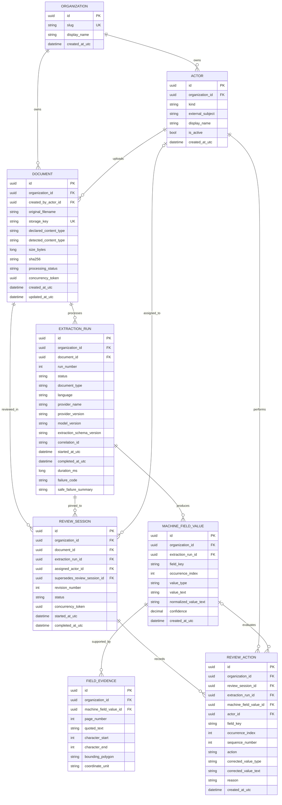
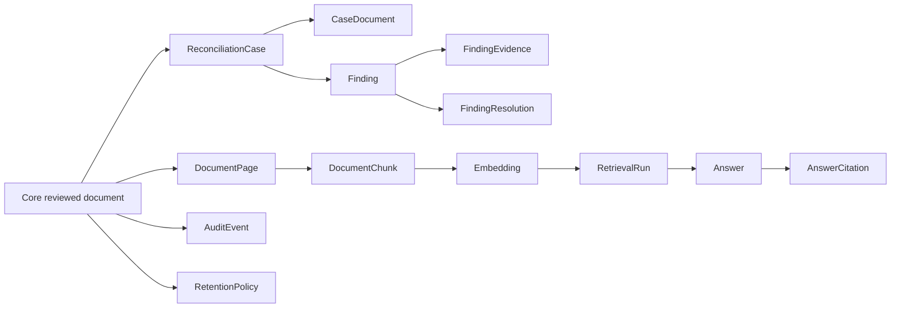

# Database design and ERD

**Design status:** Approved; Integration Guardian post-implementation review passed  
**Implementation status:** Implemented locally; automated verification passed  
**Task:** P1-T02 - Phase 1 ERD and persistence contract
**Decision references:** D-008 through D-014

See the [P1-T04 database evidence](../evidence/phase-1/P1-T04-database-verification.md) and [P1-T08 acceptance verification](../evidence/phase-1/P1-T08-acceptance-verification.md). The implemented Phase 1 schema and review workflow are complete.

This page records the implemented and verified Phase 1 data model, its historical prototype, and entities intentionally deferred to later phases.

## Design goals

- Establish organization ownership before real data exists.
- Keep uploaded-document identity separate from processing attempts.
- Preserve every extraction attempt instead of overwriting machine output.
- Store evidence as a relationship that can support multiple page regions.
- Store human confirmations and corrections as append-only history.
- Prevent cross-organization relationships at the database boundary.
- Keep PostgreSQL as the canonical persistent database.
- Avoid creating reconciliation, RAG, and security tables before their phases.

Phase 1 includes only the **structural organization boundary**: organization keys and database-enforced relationship integrity. Authentication, memberships, permissions, tenant-aware authorization queries, and hostile cross-tenant access testing remain Phase 6 responsibilities.

## Historical prototype

The current prototype contains only a document and its extracted fields. It was created with `EnsureCreated`, has no migration history, and stores extraction metadata directly on the document.



This schema was the disposable prototype and is not the migration baseline. The current implementation uses the Phase 1 core model below.

## Implemented Phase 1 core ERD



## Entity responsibilities

### Organization

Defines the tenant boundary. A deterministic development organization can support local work until authentication is implemented. An organization containing documents must not be accidentally cascade-deleted.

### Actor

Attributes uploads and review actions without pretending authentication already exists. An actor is either `Human` or `System`. The development actor is seeded only for local development; a future external identity will replace it in authenticated requests.

### Document

Represents one uploaded business document and its storage metadata. It does not contain provider, model, document type, language, extraction error, or extracted fields because those belong to individual extraction attempts.

The same hash may appear on multiple document rows. A hash indicates a duplicate candidate, not business identity.

### ExtractionRun

Represents one immutable processing attempt. A retry creates another run with a higher run number. A failed retry does not erase an earlier successful run.

### MachineFieldValue

Stores one immutable extracted value. Generic field keys allow the first schema to support invoices without prematurely creating invoice-specific tables. `OccurrenceIndex` permits repeated fields and prepares for line-item structures.

### FieldEvidence

Links a machine value to one or more source locations. Phase 1 requires page-level evidence; bounding polygons become meaningful when real layout processing is added in Phase 2.

### ReviewSession

Pins a human review to one extraction run. Reopening a completed review creates a new revision rather than altering the old session. `SupersedesReviewSessionId` records which completed session it replaces.

Only one `Pending` or `InProgress` session may exist for a document at a time. PostgreSQL enforces this with a partial unique index; the application also checks it within the transaction that opens a review. A new session begins from the pinned extraction run's machine values. Prior sessions remain visible as history but their decisions are not silently copied.

### ReviewAction

Records append-only decisions: `Confirmed`, `Corrected`, `Cleared`, or `Added`. It repeats `ExtractionRunId` so composite foreign keys can prove that any referenced machine value belongs to the session's pinned run. Machine values are never overwritten. The effective reviewed value is derived from the latest valid action for a field within a review session.

Action invariants are explicit:

| Action | Machine field | Corrected value | Reason |
| --- | --- | --- | --- |
| Confirmed | Required | Must be absent | Optional |
| Corrected | Required | Required | Required |
| Added | Must be absent | Required | Required |
| Cleared | Optional; field identity remains required | Must be absent | Required |

## State transitions

### Document processing

```text
Stored -> Processing -> ReadyForReview
                     -> ExtractionFailed
```

### Extraction run

```text
Queued -> Running -> Succeeded
                  -> Partial
                  -> Failed
                  -> Cancelled
```

### Review session

```text
Pending -> InProgress -> Completed
                      -> Cancelled
```

The public document state is projected only from the `Document` aggregate:

| Database state | Existing API state |
| --- | --- |
| Stored, Processing | Processing |
| ReadyForReview | Ready |
| ExtractionFailed | Failed |

Extraction-run status is exposed separately when the UI needs attempt history. `Partial` is not considered successful in Phase 1 and does not become the selected output.

EF entities must not be serialized directly after this migration. Explicit API DTOs will protect the browser contract from database changes.

## Keys, constraints, and indexes

### Tenant-aware relationships

Every tenant-owned table contains `OrganizationId`. In addition to globally unique UUID primary keys, the physical schema uses the following alternate keys and composite foreign keys. These are mandatory, not application conventions.

### Principal alternate keys

- Actor: `(OrganizationId, Id)`
- Document: `(OrganizationId, Id)`
- ExtractionRun: `(OrganizationId, Id)`
- ExtractionRun: `(OrganizationId, DocumentId, Id)`
- MachineFieldValue: `(OrganizationId, Id)`
- MachineFieldValue: `(OrganizationId, ExtractionRunId, Id, FieldKey, OccurrenceIndex)`
- ReviewSession: `(OrganizationId, Id, ExtractionRunId)`
- ReviewSession: `(OrganizationId, DocumentId, Id)`

### Composite foreign keys

- `Document (OrganizationId, CreatedByActorId)` -> `Actor (OrganizationId, Id)`
- `ExtractionRun (OrganizationId, DocumentId)` -> `Document (OrganizationId, Id)`
- `MachineFieldValue (OrganizationId, ExtractionRunId)` -> `ExtractionRun (OrganizationId, Id)`
- `FieldEvidence (OrganizationId, MachineFieldValueId)` -> `MachineFieldValue (OrganizationId, Id)`
- `ReviewSession (OrganizationId, DocumentId, ExtractionRunId)` -> `ExtractionRun (OrganizationId, DocumentId, Id)`
- `ReviewSession (OrganizationId, AssignedActorId)` -> `Actor (OrganizationId, Id)` when assigned
- `ReviewSession (OrganizationId, DocumentId, SupersedesReviewSessionId)` -> `ReviewSession (OrganizationId, DocumentId, Id)` when superseding
- `ReviewAction (OrganizationId, ReviewSessionId, ExtractionRunId)` -> `ReviewSession (OrganizationId, Id, ExtractionRunId)`
- `ReviewAction (OrganizationId, ExtractionRunId, MachineFieldValueId, FieldKey, OccurrenceIndex)` -> `MachineFieldValue (OrganizationId, ExtractionRunId, Id, FieldKey, OccurrenceIndex)` when a machine field is referenced
- `ReviewAction (OrganizationId, ActorId)` -> `Actor (OrganizationId, Id)`

The duplicated field identity on `ReviewAction` is intentional: the composite FK prevents a confirmed/corrected action from naming a different field than the referenced machine value. For `Added` and `Cleared` actions with no machine value, check constraints and domain validation govern the explicit field identity.

A superseded session must be completed and have a lower revision number. PostgreSQL composite keys enforce the same organization/document; the transaction opening the new session validates status and revision ordering.

### Required constraints

- `Document.SizeBytes > 0`
- `Document.Sha256` is exactly 64 lowercase hexadecimal characters
- `ExtractionRun.RunNumber > 0`
- `ExtractionRun.DurationMs >= 0` when present
- `MachineFieldValue.Confidence` is between `0` and `1`
- `MachineFieldValue.OccurrenceIndex >= 0`
- `FieldEvidence.PageNumber >= 1`
- character end is not before character start
- review revision and action sequence numbers are positive
- corrected, cleared, or added values follow explicit action rules

### Required unique indexes

- `Organization.Slug`
- `Document.StorageKey`
- `(OrganizationId, DocumentId, RunNumber)`
- `(OrganizationId, ExtractionRunId, FieldKey, OccurrenceIndex)`
- `(OrganizationId, DocumentId, RevisionNumber)`
- `(OrganizationId, ReviewSessionId, SequenceNumber)`
- one active review session per `(OrganizationId, DocumentId)` where status is `Pending` or `InProgress`

The alternate keys listed above are also unique constraints required by the composite foreign-key contract, even when they duplicate a globally unique UUID component.

### Required lookup indexes

- `(OrganizationId, Document.CreatedAtUtc)`
- `(OrganizationId, Document.ProcessingStatus, CreatedAtUtc)`
- `(OrganizationId, Document.Sha256)` - deliberately non-unique
- `(OrganizationId, ExtractionRun.Status, StartedAtUtc)`
- `(OrganizationId, ReviewSession.Status, StartedAtUtc)`

## Delete behavior

| Relationship | Proposed behavior | Reason |
| --- | --- | --- |
| Organization -> tenant data | Restrict | Prevent accidental tenant erasure |
| Actor -> documents/actions | Restrict | Preserve attribution |
| Document -> extraction runs | Restrict / NoAction | Retention deletes dependents explicitly in one controlled transaction |
| Extraction run -> machine fields | Cascade | Fields have no independent lifecycle |
| Machine field -> evidence | Cascade | Evidence has no independent lifecycle |
| Document/run -> review sessions | Restrict by ordinary operations | Preserve review history |
| Review session -> actions | Restrict / NoAction | Retention deletes history explicitly in a controlled transaction |

Application code must not expose generic hard-delete operations. Retention and auditable deletion are completed in Phase 6.

## Physical column contract

This contract is the target for the initial PostgreSQL migration. `Required` means `NOT NULL` unless a database-generated default is stated.

### Organization and Actor

| Table.Column | PostgreSQL type | Required | Rule |
| --- | --- | --- | --- |
| Organization.Id | `uuid` | Yes | Application-generated primary key |
| Organization.Slug | `varchar(64)` | Yes | Lowercase; unique |
| Organization.DisplayName | `varchar(200)` | Yes | Non-empty |
| Organization.CreatedAtUtc | `timestamptz` | Yes | UTC |
| Actor.Id | `uuid` | Yes | Application-generated primary key |
| Actor.OrganizationId | `uuid` | Yes | Composite tenant-aware FK |
| Actor.Kind | `varchar(16)` | Yes | `Human` or `System` |
| Actor.ExternalSubject | `varchar(200)` | No | Unique per organization when present |
| Actor.DisplayName | `varchar(200)` | Yes | Non-empty |
| Actor.IsActive | `boolean` | Yes | Default `true` |
| Actor.CreatedAtUtc | `timestamptz` | Yes | UTC |

### Document and ExtractionRun

| Table.Column | PostgreSQL type | Required | Rule |
| --- | --- | --- | --- |
| Document.Id | `uuid` | Yes | Application-generated primary key |
| Document.OrganizationId | `uuid` | Yes | Composite tenant-aware FK |
| Document.CreatedByActorId | `uuid` | Yes | Actor from same organization |
| Document.OriginalFilename | `varchar(255)` | Yes | Display metadata only |
| Document.StorageKey | `varchar(255)` | Yes | Globally unique opaque key |
| Document.DeclaredContentType | `varchar(100)` | Yes | Client declaration, not trusted detection |
| Document.DetectedContentType | `varchar(100)` | No | Filled by content inspection later |
| Document.SizeBytes | `bigint` | Yes | Greater than zero |
| Document.Sha256 | `char(64)` | Yes | Lowercase hexadecimal |
| Document.ProcessingStatus | `varchar(32)` | Yes | `Stored`, `Processing`, `ReadyForReview`, `ExtractionFailed` |
| Document.ConcurrencyToken | `uuid` | Yes | Application-managed and changed on updates |
| Document.CreatedAtUtc | `timestamptz` | Yes | UTC |
| Document.UpdatedAtUtc | `timestamptz` | Yes | UTC; not earlier than creation |
| ExtractionRun.Id | `uuid` | Yes | Application-generated primary key |
| ExtractionRun.OrganizationId | `uuid` | Yes | Same organization as document |
| ExtractionRun.DocumentId | `uuid` | Yes | Composite tenant-aware FK |
| ExtractionRun.RunNumber | `integer` | Yes | Positive and unique per document |
| ExtractionRun.Status | `varchar(16)` | Yes | `Queued`, `Running`, `Succeeded`, `Partial`, `Failed`, `Cancelled` |
| ExtractionRun.DocumentType | `varchar(50)` | No | Provider result |
| ExtractionRun.Language | `varchar(20)` | No | BCP 47-compatible value where possible |
| ExtractionRun.ProviderName | `varchar(100)` | Yes | Non-empty |
| ExtractionRun.ProviderVersion | `varchar(100)` | Yes | Non-empty |
| ExtractionRun.ModelVersion | `varchar(100)` | No | Provider/model identifier |
| ExtractionRun.ExtractionSchemaVersion | `varchar(50)` | Yes | Normalized output schema version |
| ExtractionRun.CorrelationId | `varchar(100)` | Yes | Indexed request/trace correlation |
| ExtractionRun.StartedAtUtc | `timestamptz` | No | Required after transition to `Running` |
| ExtractionRun.CompletedAtUtc | `timestamptz` | No | Required for terminal status |
| ExtractionRun.DurationMs | `bigint` | No | Non-negative |
| ExtractionRun.FailureCode | `varchar(100)` | No | Safe stable code for failed/cancelled run |
| ExtractionRun.SafeFailureSummary | `varchar(500)` | No | Must not contain secrets or document text |

### MachineFieldValue and FieldEvidence

| Table.Column | PostgreSQL type | Required | Rule |
| --- | --- | --- | --- |
| MachineFieldValue.Id | `uuid` | Yes | Application-generated primary key |
| MachineFieldValue.OrganizationId | `uuid` | Yes | Same organization as run |
| MachineFieldValue.ExtractionRunId | `uuid` | Yes | Composite tenant-aware FK |
| MachineFieldValue.FieldKey | `varchar(100)` | Yes | Stable schema key |
| MachineFieldValue.OccurrenceIndex | `integer` | Yes | Default `0`; non-negative |
| MachineFieldValue.ValueType | `varchar(32)` | Yes | `String`, `Decimal`, `Date`, `Currency`, or `Identifier` initially |
| MachineFieldValue.ValueText | `text` | Yes | Immutable provider value |
| MachineFieldValue.NormalizedValueText | `text` | No | Versioned normalization result |
| MachineFieldValue.Confidence | `numeric(5,4)` | Yes | Between `0.0000` and `1.0000` |
| MachineFieldValue.CreatedAtUtc | `timestamptz` | Yes | UTC |
| FieldEvidence.Id | `uuid` | Yes | Application-generated primary key |
| FieldEvidence.OrganizationId | `uuid` | Yes | Same organization as field |
| FieldEvidence.MachineFieldValueId | `uuid` | Yes | Composite tenant-aware FK |
| FieldEvidence.PageNumber | `integer` | Yes | One-based positive number |
| FieldEvidence.QuotedText | `text` | No | Bounded in application to 4,000 characters |
| FieldEvidence.CharacterStart | `integer` | No | Paired with character end; non-negative |
| FieldEvidence.CharacterEnd | `integer` | No | Not before start |
| FieldEvidence.BoundingPolygon | `text` | No | Provider-portable serialized coordinates |
| FieldEvidence.CoordinateUnit | `varchar(16)` | No | Required when polygon is present |

### ReviewSession and ReviewAction

| Table.Column | PostgreSQL type | Required | Rule |
| --- | --- | --- | --- |
| ReviewSession.Id | `uuid` | Yes | Application-generated primary key |
| ReviewSession.OrganizationId | `uuid` | Yes | Same organization as document/run |
| ReviewSession.DocumentId | `uuid` | Yes | Composite relationship to pinned run |
| ReviewSession.ExtractionRunId | `uuid` | Yes | Must belong to session document |
| ReviewSession.AssignedActorId | `uuid` | No | Actor from same organization |
| ReviewSession.SupersedesReviewSessionId | `uuid` | No | Completed session for same document |
| ReviewSession.RevisionNumber | `integer` | Yes | Positive and unique per document |
| ReviewSession.Status | `varchar(16)` | Yes | `Pending`, `InProgress`, `Completed`, `Cancelled` |
| ReviewSession.ConcurrencyToken | `uuid` | Yes | Application-managed |
| ReviewSession.CreatedAtUtc | `timestamptz` | Yes | UTC |
| ReviewSession.StartedAtUtc | `timestamptz` | No | Required after work begins |
| ReviewSession.CompletedAtUtc | `timestamptz` | No | Required for completed/cancelled status |
| ReviewAction.Id | `uuid` | Yes | Application-generated primary key |
| ReviewAction.OrganizationId | `uuid` | Yes | Same organization as session |
| ReviewAction.ReviewSessionId | `uuid` | Yes | Composite FK with extraction run |
| ReviewAction.ExtractionRunId | `uuid` | Yes | Must equal session's pinned run |
| ReviewAction.MachineFieldValueId | `uuid` | No | Required by action matrix |
| ReviewAction.ActorId | `uuid` | Yes | Actor from same organization |
| ReviewAction.FieldKey | `varchar(100)` | Yes | Target field identity |
| ReviewAction.OccurrenceIndex | `integer` | Yes | Default `0`; non-negative |
| ReviewAction.SequenceNumber | `integer` | Yes | Positive and unique per session |
| ReviewAction.Action | `varchar(16)` | Yes | `Confirmed`, `Corrected`, `Added`, `Cleared` |
| ReviewAction.CorrectedValueType | `varchar(32)` | No | Required with corrected/added value |
| ReviewAction.CorrectedValueText | `text` | No | Governed by action matrix |
| ReviewAction.Reason | `varchar(500)` | No | Required for correction/add/clear |
| ReviewAction.CreatedAtUtc | `timestamptz` | Yes | UTC and append-only |

### Foreign-key delete contract

- All organization foreign keys: `Restrict/NoAction`.
- Document uploader and review actor references: `Restrict/NoAction`.
- Document to extraction runs and review sessions: `Restrict/NoAction`.
- Extraction run to machine fields: `Cascade`.
- Machine field to evidence: `Cascade`.
- Review session to actions: `Restrict/NoAction`.
- Review action to optional machine field: `Restrict/NoAction`.
- Review-session supersession: `Restrict/NoAction`.

Deletion of a complete document aggregate is therefore an explicit retention-service transaction, not an implicit root cascade.

## Data representation

- UUIDs for entity identity
- UTC timestamps throughout
- Decimal for confidence and future money values
- ISO 4217 codes such as `AED` for currency
- String-backed statuses with database check constraints
- Opaque storage keys rather than client filenames as paths
- Lowercase hexadecimal SHA-256 values
- Provider-portable text representation for initial bounding polygons

## Database ownership

ASP.NET Core exclusively owns this transactional schema, EF Core mappings, migrations, and organization relationship integrity. Python returns versioned extraction results but does not write directly to PostgreSQL. Tenant-aware query authorization is added and tested in Phase 6.

For future RAG, Python may create embeddings and query vectors, while persistence and tenant-scoped retrieval remain behind an explicitly approved ownership boundary.

## Current extraction selection

The system distinguishes the latest attempt from the selected output:

- **Latest attempt:** the extraction run with the highest `RunNumber` for the document.
- **Selected output:** the extraction run with the highest `RunNumber` whose status is `Succeeded`.
- A retry always creates a new run number in a transaction.
- A failed or partial retry remains visible but does not replace a prior successful output.
- If the first attempt fails or is partial, the document becomes `ExtractionFailed`.
- If a retry fails after a successful run, the document remains `ReadyForReview`; the failed latest attempt is reported separately.
- When a run succeeds, its fields and evidence are committed before the document is atomically moved to `ReadyForReview`.

This deterministic rule avoids a nullable current-run pointer and prevents a failed retry from hiding previously reviewable data.

## Approved migration policy - Decision D-008

- PostgreSQL 16 is the canonical persistent provider. The Compose image includes pgvector. Phase 5 migration 14 now enables the extension and adds canonical chunk-vector storage; live embedding ingestion remains open.
- EF Core Code First migrations own schema evolution.
- `EnsureCreated` must not run against persistent databases.
- Migrations are applied as a controlled deployment step, not concurrently by every application replica.
- The existing prototype database and its synthetic data are disposable and will be reset rather than imported.
- SQLite may remain a limited local fallback, but it is not evidence of PostgreSQL compatibility.
- PostgreSQL tables and columns use snake_case names from the initial migration. Explicit domain indexes and checks also use descriptive snake_case names; framework-generated supporting identifier names are not portfolio claims.

## Deferred conceptual model

These entities influence the core design but must not be migrated in the first database task.



### Phase 2 - processing

`DocumentAsset`, `DocumentPage`, `ProcessingJob`, `JobAttempt`, `IdempotencyRecord`, and `OutboxMessage`.

### Phase 3 - evaluation

`Dataset`, `DatasetVersion`, `GroundTruthDocument`, `GroundTruthField`, `EvaluationRun`, `EvaluationPrediction`, and `MetricResult`.

### Phase 4 - reconciliation

`ReconciliationCase`, `CaseDocument`, `ReviewedDocumentSnapshot`, `CanonicalLineItem`, `RuleSetVersion`, `Finding`, `FindingEvidence`, and `FindingResolution`.

### Phase 5 - RAG

Implemented provider-independent foundation as of 2026-09-07:

- `cited_document_indexes` pins one completed review and versioned chunk profile.
- `document_chunks` and `chunk_evidence_spans` store content and exact page evidence.
- `cited_retrieval_runs`, `retrieval_sources`, and `retrieval_hits` freeze the corpus and ranked evidence.
- `cited_answers`, `answer_claims`, and `answer_citations` persist cited claims and refusal outcomes.

Migration `20260907001143_AddCitedQuestionFoundation` uses organization-scoped
composite foreign keys, restrictive deletes, concurrency tokens, unique request
keys, and a canonical-page quote-check trigger. Domain/EF guards protect tracked
history writes. Embedding/vector storage was originally deferred until model selection;
this foundation does not enable a retrieval API. See
[P5-T03 evidence](../evidence/phase-5/P5-T03-persistence-verification.md).

Migration `20260910005624_AddCitedChunkEmbeddings` adds the SQL-owned
`cited_chunk_embeddings` table with pgvector `vector(1536)`, source-hash and
organization foreign keys, settled-outcome provenance and immutable rows.
`ICitedEmbeddingStore` verifies saved provider artifacts before insertion or
exact cosine search. Chunk vectors are reusable; query vectors remain in their
own journal outcomes and cannot populate this table. EF migrations own its DDL,
while parameterized Npgsql commands own vector operations without mapping a
vector type into the domain. See the
[storage contract](../design/phase-5-embedding-storage-contract.md).

### Phase 6 - security and audit

`ExternalIdentity`, `OrganizationMembership`, `Role`, `Permission`, `RoleAssignment`, `AuditEvent`, `RetentionPolicy`, and `DeletionRequest`.

## Approved decisions — 2026-08-07

1. Discard the prototype database and synthetic prototype data; no import migration is required.
2. Use PostgreSQL as the canonical database and treat SQLite only as a limited local convenience fallback.
3. Seed one development organization and system actor before authentication exists.
4. Require an actor for every review action. Require a reason for `Corrected`, `Added`, and `Cleared`; a `Confirmed` action may omit it.
5. Keep document-processing and human-review states separate while preserving the current browser contract through explicit API DTOs.
6. Use snake_case physical names from the initial migration.
7. Use EF Core Code First for the relational model and migrations.
8. Implement the ASP.NET backend as a modular monolith with Clean Architecture boundaries, Vertical Slice organization, and DDD-lite modeling.

Implementation, automated verification, and the Integration Guardian post-implementation review are complete for the database foundation.

## Database task acceptance criteria

- [x] Rand approved the decisions above on 2026-08-07.
- [x] Integration Guardian approved the implemented contract after post-review fixes and regressions.
- [x] A clean PostgreSQL database migrates from zero to latest.
- [x] Applying the migration again is harmless.
- [x] Generated constraints, indexes, foreign keys, and delete rules match this page.
- [x] Two-organization tests prove database relationship integrity rejects cross-organization references.
- [x] Tenant-aware query authorization and hostile read-isolation tests remain explicitly deferred to Phase 6.
- [x] Reprocessing creates immutable extraction history.
- [x] Corrections preserve the original machine value.
- [x] Duplicate hashes remain scoped duplicate candidates.
- [x] Migration rollback and reapplication succeed in a disposable database.
- [x] The application no longer mixes `EnsureCreated` with persistent migrations.

## Change history

### 2026-09-09 - Cited generation artifacts

- Migration `20260909123847_AddCitedGenerationArtifacts` adds immutable, bounded
  preparation/outcome bytes and hashes scoped to the reservation's organization
  and actor, with one record per kind per reservation.
- Preparation/reservation and outcome/settlement commit atomically through the
  existing ledger. Unknown usage retains its hold; saved synthetic results can
  replay after current scope/source checks without another adapter request.
- EF and SQL row guards are not encryption, privileged-owner protection or a
  retention policy. After 541 backend tests passed, the retained synthetic
  database was backed up and upgraded from migration 9 to 12 without resetting
  its existing documents/history. Only the test fixture is reset/dropped.
  See the [journal review](../evidence/phase-5/P5-generation-journal-transport-verification.md).

### 2026-09-09 - Cited recovery audit

- Migration `20260909002217_AddCitedRecoveryAudit` adds scoped, attributable
  cancellation/settlement audits, stable request replay and unique evidence use.
- A recovery event, reservation state and spending update commit together.
  Original requester and active recovery operator remain separate identities.
- EF and PostgreSQL row UPDATE/DELETE guards protect the new audit records;
  privileged database tampering/backup restoration remain operational gates.
- This migration is exercised only in the disposable fixture in this increment.
  See the [execution review](../evidence/phase-5/P5-T08-recovery-execution-verification.md).

### 2026-09-07 - Provider-independent lexical retrieval

- Migration `20260907013111_AddLexicalRetrieval` adds an English full-text GIN
  expression index on chunk content and the intermediate Retrieved run state.
- Retrieved runs have fixed retrieval duration and ranked evidence, but no
  required answer yet. Later answer/refusal completion remains separate.
- Populated downgrade maps Retrieved to Failed (`schema_downgrade`) and retains
  hits. No embedding dimension or vector extension was chosen.
- See the [lexical retrieval contract](../design/phase-5-lexical-retrieval-contract.md)
  and [verification](../evidence/phase-5/P5-T05-lexical-verification.md).

### 2026-08-11 - Review workflow completed

- Added migration `20260811073607_AddReviewActionValueTypeConstraint`.
- Verified review revision, append-only actions, effective reviewed values, completion, ETag rotation, and reload persistence.
- Passed the final 100-test .NET suite and Integration Guardian approval review.
- Marked Phase 1 complete while preserving authentication, Arabic/OCR, RAG, reconciliation, and deployment as later work.

### 2026-08-07 - Implemented, reviewed, and verified

- Replaced the historical prototype with Domain, Application, Infrastructure, and API projects.
- Added the initial Npgsql migration and development organization/system-actor seed.
- Passed the final 71-test .NET suite: 45 domain, 7 application, 2 infrastructure, 4 architecture, 8 PostgreSQL persistence, and 5 API contract tests.
- Reproduced a post-fix synthetic invoice upload/read result with `Ready` status, 9 fields, and extractor `mock-invoice-v1`.
- Completed the Integration Guardian post-implementation review and required regression fixes.

### 2026-08-07 - Database decisions approved

- Recorded PostgreSQL and EF Core Code First as the approved persistence approach.
- Confirmed disposal of the prototype database, development seeds, review attribution rules, separate state models, DTO compatibility, and snake_case naming.
- Recorded the modular-monolith, Clean Architecture, Vertical Slice, and DDD-lite direction for the ASP.NET backend.
- Kept implementation status at **Not implemented** at that decision-only checkpoint.

### 2026-08-07 - Initial draft

- Replaced the prototype two-table shape with a proposed tenant-ready, versioned model.
- Separated document identity, extraction attempts, evidence, and human review history.
- Kept reconciliation, RAG, complete identity, audit, and operations tables conceptual until their phases.
