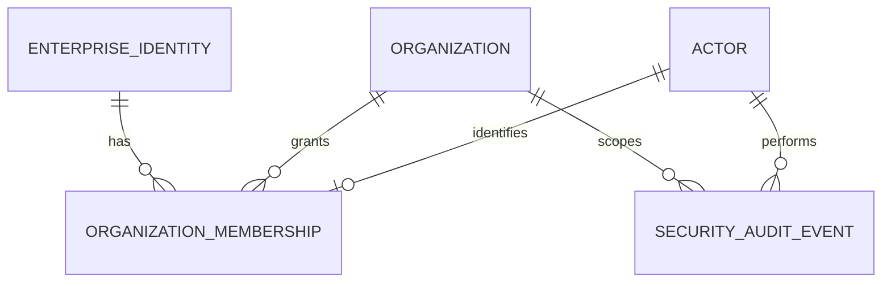

# Organization membership and security audit

September 15 addition: [audit operations](phase-6-audit-operations.md) persists an
admission event before parsing each authorized, budget-admitted mutation or source
download. Admission is not proof of business success. It closes the attempt gap for
later body-binding failures. [Private export and retention](phase-6-audit-export-retention.md)
now provide bounded operator snapshots, offline archive verification and the local
indefinite-retention policy without granting audit rewrite/delete permissions.
The [operational coverage map](../security/phase-6-audit-coverage.md) now accepts the
local audit contract, including 25 named admission operations and atomic semantic
retrieval events. Private operator boundaries and missing historical events remain
explicit; overall Phase 6 acceptance is tracked separately.

September 12 addition: the [worker contract](phase-6-worker-security.md) provisions
separate System actors and commits queue-transition events into the same append-only
audit table. It neither grants workers human memberships nor remaps document creators.

September 11, 2026. This backend increment implements the approved membership and
audit design. Browser sign-in, live Entra testing and the remaining Phase 6 controls
are tracked separately. Phase 5 retained data and spending history stay unchanged.

## Identity, organization and actor

`enterprise_identities` stores an immutable internal UUID and unique Entra tenant
and object UUIDs. Email and display name are not identity keys. Membership stores
organization, enterprise identity, existing actor UUID, data role, administrator
grant, active status, timestamps and a concurrency version. Composite foreign keys
keep actor and organization aligned. No public operation replaces these bindings
or deletes memberships. Revoked memberships and actors retain their historical IDs.

One active organization per enterprise identity is enforced by a filtered unique
index. After revocation, another organization can grant that identity membership
with a new actor; the old organization keeps its history. Reactivation fails while
another active organization exists. Multi-organization switching requires an explicit
future schema and API change. No organization selector is inferred from client input.

Every Entra request resolves membership afresh. Permission comes from the database,
regardless of token role claims. `None` grants no document access; Viewer can read and
ask; Reviewer adds review/reconciliation/indexing; Operator adds upload/reprocessing/
cancellation. `CanManageMembers` separately grants membership and audit administration.
An administrator may explicitly grant data access, including to themselves. A data
role alone cannot grant administration. Revocation and role changes apply to subsequent
requests; requests already admitted may finish.

## Provisioning and administration

The private CLI is `apps/backend/tools/EnterpriseAdmin`. Run its `bootstrap` command
with a local JSON file containing `slug`, `name`, `tenantId`, `objectId` and
`administratorName`. Supply the operator connection through `PHASE6_ADMIN_CONNECTION`.
Keep that environment and input file private. Output contains only created UUIDs.
The CLI creates a new organization, a new System provisioning actor, a new Human
administrator, identity/membership and two security events in one transaction.
The initial data role is `None` with administrator access. Duplicate active identity
or organization slug rolls everything back. Bootstrap has no HTTP endpoint, performs
no migration or seed, registers no provider, and refuses database names starting
with `phase5_`.

After bootstrap, signed-in organization administrators use:

| Endpoint | Result |
| --- | --- |
| `GET /api/organization/memberships` | Own organization's memberships, including revoked entries; first 500 ordered by membership UUID |
| `POST /api/organization/memberships` | Grant by configured Entra tenant/object UUID, display name, exact data role and administrator boolean |
| `PUT /api/organization/memberships/{id}` | Change role, administrator flag and active state using `expectedVersion` |
| `GET /api/organization/audit?offset=0` | Own organization's latest audit events; pages of 100, offset 0–10,000 |

Version mismatches and duplicate memberships return 409. A foreign membership UUID
returns 404. The service locks the organization row and rechecks administrator access
before any membership write. Concurrent removals cannot eliminate the final active
Human administrator. A revoked member can be reactivated through the versioned update;
POST does not silently overwrite an existing membership. There are no invitation emails,
automatic Entra directory lookup or public signup. Administrators obtain object IDs
through their trusted directory process. Membership listing beyond 500 and cursor-based
audit export remain future work. The separate private operator tool exports a bounded
organization/time snapshot; it does not add a cursor or browser export endpoint.

## Audit events and transaction boundary

`security_audit_events` is separate from review history and the Phase 5 spending ledger.
Events contain database-clock UTC time, organization and actor UUIDs when resolved,
actor kind, action, target type/UUID, outcome, reason code, request ID, and optional
before/after enum state or membership role/admin/active flags. Request IDs are bounded
correlation values and are not identity proof. No token, secret, filename, document text,
question, answer, corrected field value, display name or free-form reason is serialized.

Tracked successful changes create events inside the same EF SaveChanges and business
transaction: organization/membership creation and changes; document upload and status;
extraction queue changes; review start/action/completion; reconciliation case/link/run/
finding resolution; evidence indexing/eligibility; and saved question/retrieval state.
A failed audit insert rolls back the associated database change. Upload compensation
removes its newly written file if persistence fails. An idempotent request that changes
no state does not create another success event. Later failure can coexist with events
for earlier stages that actually committed; events describe committed stages, not a
promise that the entire workflow completed successfully.

Authorization denials in Entra mode use a separate database context. Failed admitted
mutation results and caught exceptions are also recorded separately, so rejected
tracked changes cannot accidentally be flushed. Audit failure returns 503 and never
admits access or claims a successful mutation. Denial targets use server route categories
and parsed UUIDs; raw URLs, queries and bodies are excluded. Unauthenticated, malformed
claim and unresolvable/revoked membership denials have no trusted organization or actor
and are available only to a private database operator. A valid resolved member's role
denial belongs to that organization. No global audit HTTP endpoint exists.

This is a sensitive state-change and admission audit, not an HTTP access log. Routine
successful reads and pre-admission middleware rejections are not a complete attempt
trail. Body-binding failures after admission retain their admission event but may
have no terminal event. Client disconnects and process death can also leave an unknown
outcome. Development and standalone pilot tools do not bind this enterprise context.
Workers use the dedicated System authority described in the worker contract above.

## Database protection and deployment

Migration `20260911162600_AddEnterpriseMembershipAndAudit` adds three tables; it does
not alter prior document/history/spending rows or map old actors. Apply only to a
reviewed deployment database. It has been exercised on disposable data; the retained
Phase 5 database must not be migrated as part of this increment.

EF rejects changes/deletions to saved audit events. A PostgreSQL trigger rejects
UPDATE, DELETE and TRUNCATE, including ordinary DML by the table owner. Migration
downgrade refuses to erase populated identities, memberships or audit history.
The deployment script `tools/phase6_runtime_security_grants.sql` configures an existing
runtime role with SELECT/INSERT on audit and identity tables and only access-state
column updates on memberships. It rejects owners, elevated roles, schema CREATE and
inherited forbidden privileges. It is repeatable and creates no login/password. Apply
it as the deployment owner with `psql -v runtime_role=enterprise_api -f ...` after
granting the deployment's required existing workflow permissions. This script covers
the new security tables, not all application database privileges.

Use a separate migration/provisioning identity. The current local development connection
is an owner and is not a production runtime credential. A database owner/superuser can
still alter/drop protections; this is not cryptographic tamper evidence or external
immutable storage. The private export runbook defines local indefinite retention and
verified archive restoration; off-host immutable storage and production expiry remain
optional future work. Anonymous denial auditing depends on database availability and
can create storage load; the later request-limit increment bounds admission traffic.
