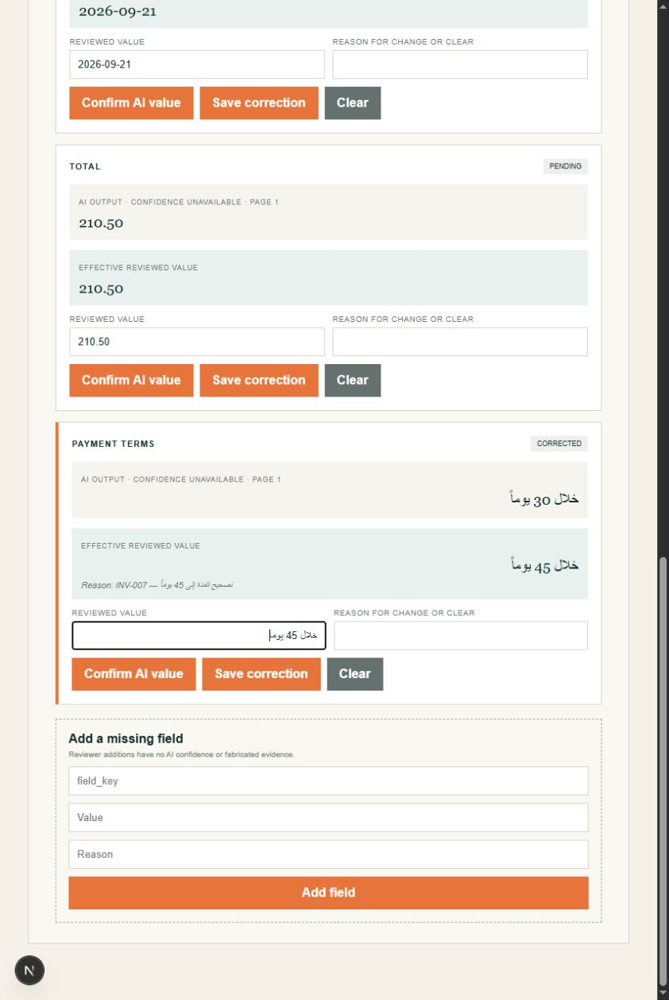
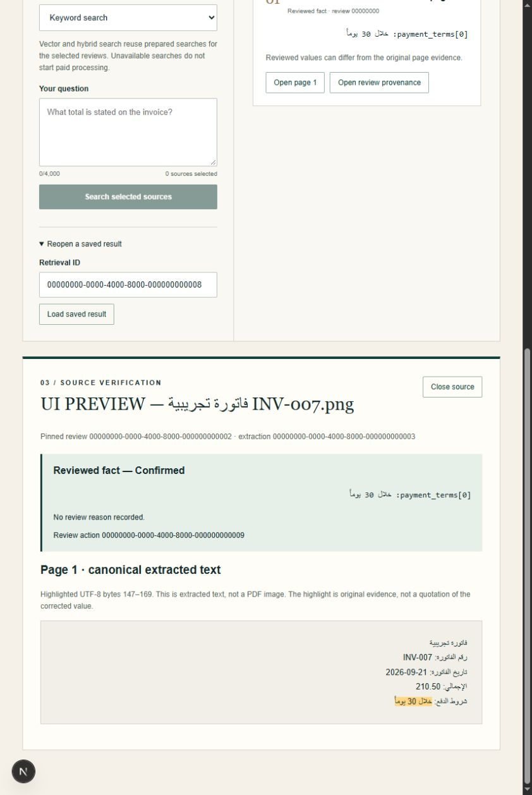

# Phase 7 standard numerics and RTL verification

September 21, 2026. Phase 7 remains in progress. All documents in this evaluation
are synthetic; these scores do not establish real-invoice accuracy.

## What failed and what changed

The first v0.2.0 image run exposed a renderer defect: an Arabic line containing
`2026-09-21` visibly showed `21-09-2026`. The engine was scored against text that
did not match the image. The `isolated-v2` rendering profile now isolates numeric
and Latin runs and chooses the base direction per line. Dataset labels were not
changed. `legacy-v1` remains available to reproduce that defect. The original
[failed render run](./P7-standard-render-failure-20260921.json) and
[isolated run before application fixes](./P7-standard-isolated-before-fixes-20260921.json)
are preserved, as is the older optional Arabic-Indic dataset.

Two application defects were fixed. An invalid/conflicting due date is omitted;
its warning must therefore be document-scoped, rather than reference a nonexistent
field and fail validation of the entire extraction. OCR's boundary LRM/RLM/ALM
characters are now excluded from field spans; a direction mark alone cannot
become a total. Canonical text remains unchanged and quotes still select exact
UTF-8 source bytes. We do not guess values displaced by reading-order errors.

## Offline model comparison

Both final runs use the same nine v0.2.0 cases, identical PNG hashes, DejaVu Sans
and `isolated-v2`. Each cell counts cases passing every expected field, required
warning, language check and exact-evidence check.

| Arabic model | OCR mode | Arabic | Mixed | English |
| --- | --- | --- | --- | --- |
| fast | eng | 0/5 | 0/3 | 1/1 |
| fast | ara | 3/5 | 0/3 | 0/1 |
| fast | ara+eng | 2/5 | 1/3 | 1/1 |
| fast | eng+ara | 2/5 | 1/3 | 1/1 |
| best | eng | 0/5 | 0/3 | 1/1 |
| best | ara | 3/5 | 0/3 | 0/1 |
| best | ara+eng | 3/5 | 1/3 | 1/1 |
| best | eng+ara | 5/5 | 1/3 | 1/1 |

Receipts: [fast](./P7-standard-fast-20260921.json),
[best candidate](./P7-standard-best-20260921.json). No final run returns the earlier
`internal_extraction_error`. Unreadable English-only OCR of Arabic still fails
with `unsupported_document`, and other recognition failures remain in the receipts.

The best candidate with `eng+ara` correctly extracts standard invoice/date/amount
fields in these five Arabic cases. `mixed-identifiers` has correct ID, TRN,
currency and total, but misreads payment wording. `mixed-neighbor-fields` still
misreads a crowded subtotal/VAT/total row. Do not promote a partial case to a pass.

The candidate comes from the official
[Tesseract tessdata_best 4.1.0 release](https://github.com/tesseract-ocr/tessdata_best/tree/4.1.0).
Its SHA-256 is `ab9d157d8e38ca00e7e39c7d5363a5239e053f5b0dbdb3167dde9d8124335896`.
The evaluation-only subclass verifies that pin and the existing English/OSD pins.
Application defaults and the approved Arabic fast pin remain unchanged. Both
comparisons ran with networking disabled in image `uaedi-phase7-ocr-v1`, ID
`sha256:235ca09593f7e88a21362b966d881478415513d5df2d66d620d4908f9c3ba3b5`.

## Actual frontend visual check

The real Next pages ran on loopback port 3327 against
`tools/phase7_workspace_preview.mjs` on port 8327. This is an in-memory synthetic
adapter, not a persisted review/QA acceptance run. The review and citation fixtures
are independent: correcting the preview field does not update the frozen citation
fixture. It must never be used to demonstrate persisted answer correctness.

The browser saved `خلال 45 يوماً` with reason
`تصحيح المدة إلى 45 يوماً — INV-007`, then displayed the saved value/reason after
navigation. The Arabic question `ما شروط دفع الفاتورة؟` opened the synthetic
answer and its original evidence at UTF-8 bytes 147–169. Reopening its in-memory
result also worked. History export, completed-review transitions and reconciliation
were not exercised by this preview.

Visual inspection exposed the same date-order issue in the original evidence
viewer. `BidiText` now isolates whole numeric/Latin runs using markup, including
dates and identifiers, while keeping `textContent` and the highlighted source
slice intact. Highlights can cross or split a run without changing its displayed
date order. The 842-pixel-wide review view also overflowed; the review columns now
stack up to 1000 pixels.

Final verified captures:

Earlier captures are retained as diagnostics. `P7-rtl-evidence-fixed-20260921.png`
was taken before the browser reloaded the new bundle and does not prove the fix.
Only the final captures above represent the final visual verification.

## Validation and remaining work

Focused Python: 48 passed, 6 explicitly gated skips, 43 subtests. Canonical-text
evaluation remains 9/9. The changed citation page and new display component pass
20 browser component tests. The latter checks include exact text retention and a
highlight crossing numeric runs. Prior broader regression results remain in the
foundation report and are not counted again here.

TypeScript, focused ESLint, isolated Python E4/E7/E9/F lint, and the documentation
build pass. ESLint was first invoked from the repository root without its web
configuration, then rerun successfully from `apps/web`. The docs build retains
the existing large-chunk warning. No new dependency was installed for these fixes.

Remaining: crowded mixed layouts and payment wording, native/multipage and
realistic invoice coverage, persisted Arabic review/answer journeys, broader RTL
history/reconciliation checks, and multilingual semantic retrieval evaluation.
No paid calls or retained database changes were made. The temporary services and
Docker instance used for this increment are stopped after verification.
