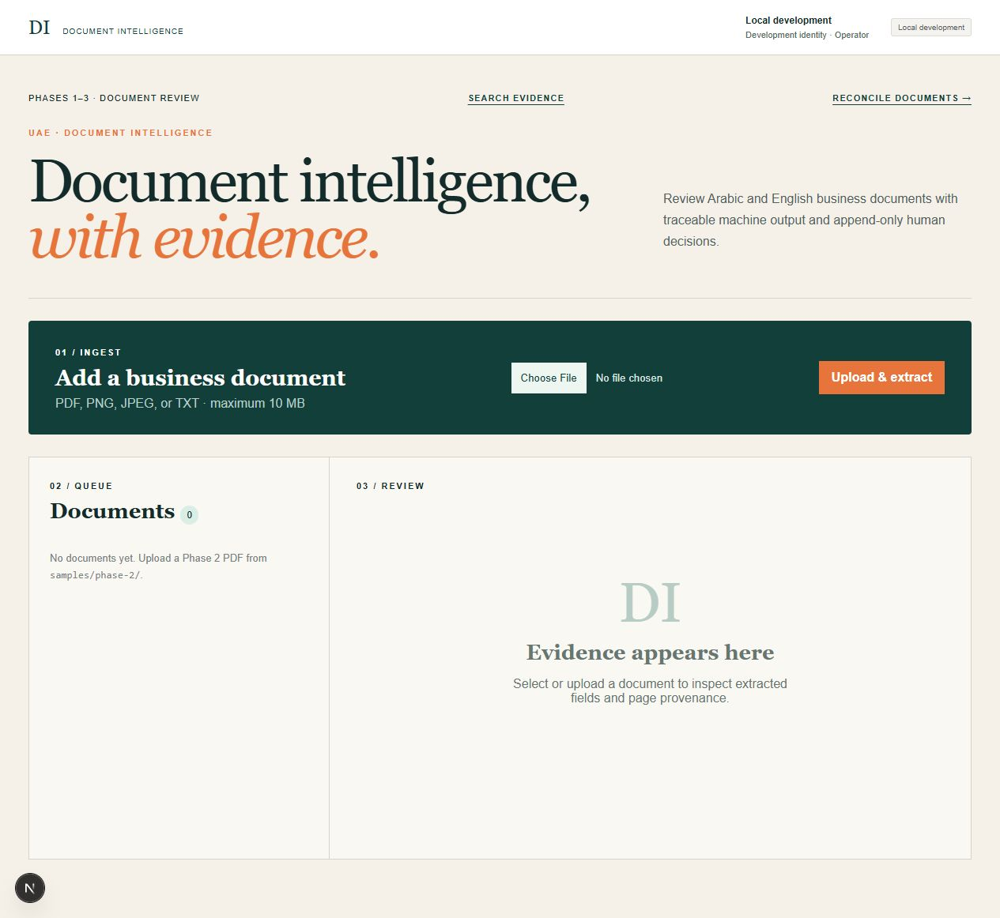
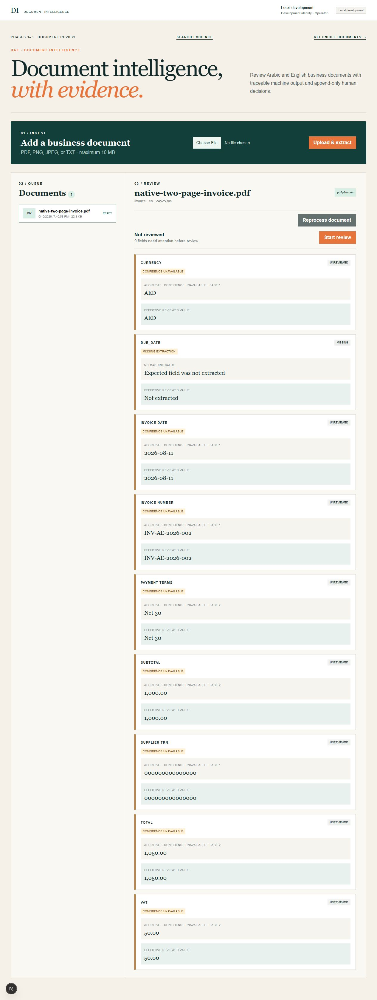
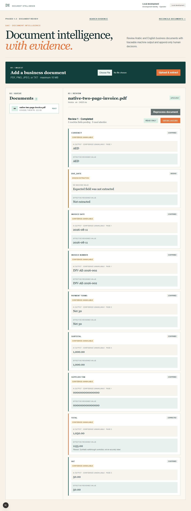
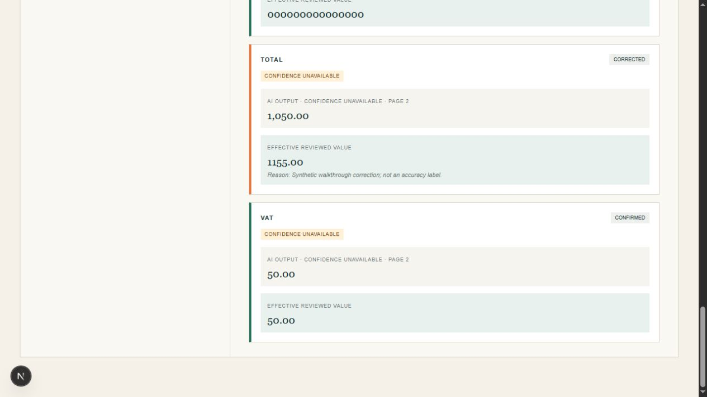

# Phase 8 local demo verification — September 16, 2026

Upload, extraction, review, persistence and reset pass for the isolated synthetic
demo. The [runbook](../../local-demo.md) is the reproduction entry point.

## Scope and source

Windows PowerShell 7 / Docker Desktop Linux containers. This increment uses one
fictional English native PDF, local extraction, existing Development identity and
disposable Docker volumes. Phase 6 remains accepted for its documented local scope;
Phase 7 Arabic/bilingual work remains pending. This is not production deployment,
OCR accuracy, CI or publication acceptance.

The verification copy is `outputs/local-demo/4b297fab4fb0`, project
`uaedi-demo-4b297fab4fb0`. Its 295-file SHA-256 inventory includes the current
uncommitted application implementation, not HEAD. Existing
dependencies, environment files, retained data, logs and Git history were excluded.
The only PDF is the Phase 2 native synthetic invoice; its source register identifies
CC0 fictional content and the included Bitstream Vera redistribution notice.

A final startup copy, `outputs/local-demo/5a61b2aebc85`, adds a TCP-specific
PostgreSQL health check. Its 295-file inventory differs from the journey copy in
only `tools/demo/compose.yml`; application and verification scripts are identical.
The [journey inventory](./P8-source-inventory-20260916.json) and
[final startup inventory](./P8-startup-source-inventory-20260916.json) identify both
snapshots. The final configuration avoids readiness against PostgreSQL's temporary
Unix-socket initialization server. Fresh migration, HTTP/browser readiness and
an empty document store all pass for that final configuration.

The separate Compose profile publishes browser `127.0.0.1:3308` and API
`127.0.0.1:8308`; PostgreSQL/Python have no published ports and use an internal
network. API/web use a separate bridge that permits outbound access; Python has
no external route or provider credential. Base images pin .NET SDK 8.0.425/runtime 8.0.31, Node 24.21.0,
Python 3.11.16 and pgvector/PostgreSQL 16 by digest. Package locks/ranges remain as
documented; byte-identical future image rebuilding is not claimed.

## Results

| Check | Observed result |
| --- | --- |
| Working-source isolation | 295 SHA-256 entries; current uncommitted runtime source included, retained data excluded |
| Setup | Four images built; dedicated migration job exits zero; 19 EF migrations |
| Host exposure | Actual API/web bindings are exactly `127.0.0.1:8308` / `127.0.0.1:3308`; no DB/Python publication |
| Final startup configuration | TCP health check passes; fresh migration job exits zero with 19 migrations; Windows listeners independently confirm loopback |
| Synthetic upload | HTTP 202; document `fa5a59f1-dd34-4d76-af45-299e260b4fac` |
| Extraction | Real local pdfplumber, English, two pages, eight machine fields; total `1,050.00` with page 2 evidence |
| Human review | Eight append-only actions; completion succeeds; machine total unchanged, effective total `1155.00` |
| Persistence | Full review HTTP response exactly identical after `down` / `up`; source PDF SHA-256 unchanged |
| Reset refusal guards | Changed Compose, foreign copy path and unexpected project volume all refused; live demo remains intact |
| Reset recovery | Only owned volumes removed, fresh migrations rerun, document list empty |
| Retained database | Read-only full-row fingerprints of every public table match before/after |
| Final shutdown | Both verification projects' containers and volumes removed; no demo containers remain; ports 3308/8308 closed |
| Documentation | VitePress build passes; four PowerShell scripts parse; scoped Git whitespace check passes |

The expected `due_date` has no extraction and is visibly marked missing. The
fixture has no due date; the walkthrough confirms existing machine fields only.
The total correction is an intentional synthetic demonstration, not a claim that
the original invoice total was wrong. HTTP scripts perform the mutations; the
browser screenshots independently show the resulting application state. Review
completion does not erase confidence/missing-field cues; those remain visible.

The [machine-readable verification receipt](./P8-local-demo-verification-20260916.json)
records identifiers, raw-response hash, fixture hash, guards and runtime bindings.
The private `outputs/local-demo/4b297fab4fb0` directory retains stage logs and the
full synthetic `journey.json`; raw operational logs are not copied into docs.
The final TCP startup and empty-store checks pass, with no unexpected database
process recovery observed in that final startup. Both verification projects are
stopped and reset; source copies, image cache and evidence are retained. The
documentation build passes with the existing large-chunk advisory. Phase 8 remains
in progress for the wider repository-delivery scope.

Four freshly rebuilt API checks passed (zero failures/skips): production
Locked/Entra anonymous document denial and refusal to start Development identity
outside local environments. No application security implementation was changed.
These focused checks do not replace the Phase 6 acceptance suite.

Observed tools: PowerShell 7.6.5, Docker Engine 29.6.2, Compose 5.3.1; application
runtimes .NET/ASP.NET 8.0.31, Node 24.21.0, Python 3.11.16 and PostgreSQL 16.14.
The runtime image IDs and actual port bindings are recorded with the verification
receipt. The SDK build stage is pinned to .NET 8.0.425.

## Screenshots

These are real browser captures of synthetic data. The existing product headline
mentions Arabic and English as product scope; **this evidence is English only**.
Phase 7 remains pending. Missing extraction and unavailable confidence are visible.

The empty workspace is from the final TCP-startup copy; extraction and reviewed
screenshots are from the journey copy whose full response survived restart.

## Attempts and limitations

- Initial Compose build paths were resolved against the project directory; the
  launcher was corrected to use root-relative build contexts.
- PowerShell array forwarding initially dropped command arguments. Named array
  binding now preserves detached startup and volume-reset flags.
- The first parallel image build was very slow on this 8 GB host and stalled at
  web export. Only that identified build client was stopped. No application
  containers had started. Completed layers were reused by sequential builds.
- An initial no-build security run selected zero tests from an older Release
  assembly. It is excluded; the rebuilt four-test run supersedes it.
- Docker Desktop did not publish ports for services attached only to the internal
  network. The final profile uses a separate API/web bridge and explicitly checks
  actual runtime host bindings before declaring readiness.
- An early upload before the full startup check completed failed during PostgreSQL
  automatic recovery (a backend process exited with code 2; root cause unproven).
  The database recovered, and the document list was empty. This failed attempt is
  excluded from acceptance; its diagnostics remain in the superseded copy.
- Another superseded cold startup also recovered automatically. No container OOM
  or matching kernel OOM record was found; the cause remains unproven. The final
  copy's initial startup reached readiness without that process-crash/recovery
  sequence. PostgreSQL's initial temporary-server shutdown is normal initialization.
- An earlier verifier expected normalized `1050.00` rather than the actual raw
  machine value `1,050.00`. The assertion was corrected without changing extraction
  or stored data; the final copy passes with the raw value.
- The demo image now extends the existing Next.js configuration with only
  `allowedDevOrigins: ['127.0.0.1']`. This fixes development-resource rejection
  while preserving the normal production configuration and authentication gate.
- The first documentation build hit sandbox directory-read restrictions; it is
  excluded. The final host build, using `tools/use-project-runtimes.ps1` and
  `npm --prefix docs run build`, passes (VitePress 1.6.4, 64.97 seconds).

The development scanner and fixed identity are local conveniences. Original-file
download remains unavailable because its Entra/enforced-storage gate is preserved.
The production web profile continues to reject Development identity. Live Entra,
TLS, deployed malware scanning, container hardening, CI, broader workflow screenshots
and license/publication review remain outside this increment. No paid provider,
external account, cloud deployment, commit, push or publication was used.

