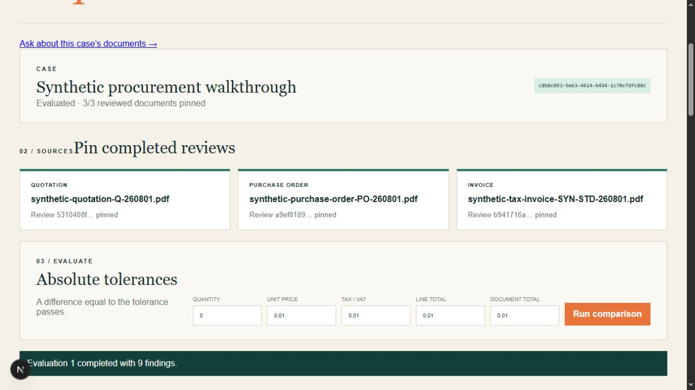
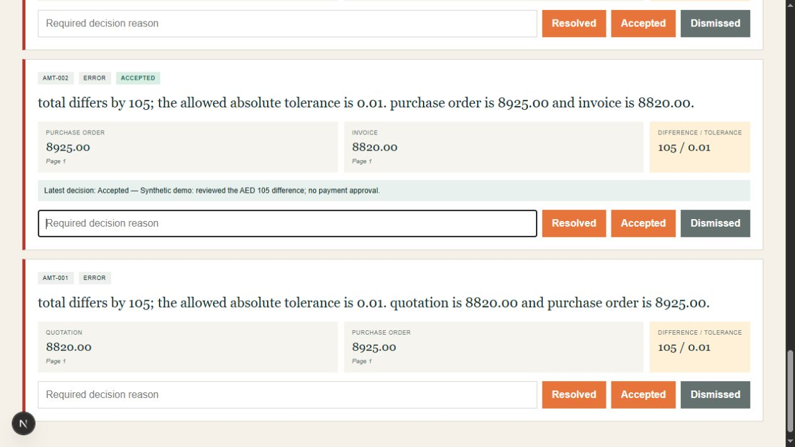

# Reconciliation demo walkthrough — September 21, 2026

The existing Phase 4 reconciliation feature now has a reproducible walkthrough
inside the disposable local demo. No reconciliation application code, rules,
tolerances, security controls or sample PDFs were changed.

Follow the [demo guide](../../local-demo.md#reconciliation-walkthrough-existing-phase-4-feature).
The [structured receipt](P8-reconciliation-receipt.json) records the verified case,
source inventory, sample hashes, screenshots and cleanup.

## What the walkthrough shows

Three existing, fictional Phase 4 PDFs are uploaded, extracted locally and given
completed review revisions by `tools/verify-demo-reconciliation.ps1 Prepare`.
This fixture preparation confirms known synthetic machine fields through the API;
it does not recommend automatically approving real documents.

In the actual browser workspace, the operator creates **Synthetic procurement
walkthrough**, pins the three completed reviews, runs the default comparison and
records one reasoned decision. The quotation and invoice total **AED 8,820**;
the purchase order totals **AED 8,925**. Their supplier, currency and first line
match. The deliberately different second line and totals produce nine findings.

The operator selects **Accepted** on `AMT-002` with the reason:
“Synthetic demo: reviewed the AED 105 difference; no payment approval.”
The original discrepancy, both values, source pages and tolerance remain visible.

## Focused verification

| Check | Observed result |
| --- | --- |
| Current working source | 304 files copied into `outputs/local-demo/1e45fce6127e`, including uncommitted implementation; all matched the workspace |
| Sample preservation | Three PDFs match the unchanged Phase 4 v0.1.0 truth-set SHA-256 values |
| Preparation | Three locally extracted documents and three completed review revisions |
| Browser flow | Create case, pin all three revisions, evaluate, accept `AMT-002` with a reason |
| Findings | All nine identities match the existing truth set; no missing or extra findings |
| Matches | Supplier TRN, currency and first-line total agree across all three frozen inputs |
| Evidence | Both field snapshots, page numbers and quoted source text exist for every finding |
| Total discrepancy | PO 8925.00 versus invoice 8820.00; absolute difference 105; tolerance 0.01 |
| Stored decision | One accepted resolution remains attached to `AMT-002`; a fresh API read returns an identical case |
| Database health | Startup and final checks pass without an abnormal process exit or crash recovery |
| Original-workspace guard | Helper refuses execution outside an owned demo before accessing its API |

The case ID is `c8b8c093-9e63-4614-b494-1c70cfdfc88c`. Raw receipts and logs remain
inside the isolated copy. The synthetic pack's CC0 declaration, provenance and
artifact hashes are included alongside it.

An initial helper attempt in `145e430debdb` failed before uploading anything:
PowerShell wrapped an empty REST array when counted directly in a pipeline.
The guard was corrected, the empty project was reset, and its failed log/source
were preserved. A further unstarted snapshot, `b82bd06f6bb0`, is retained; the
final helper explicitly sends the PDF content type required by the existing API.
The passing walkthrough used only the final snapshot named above.

## Shutdown and preservation

The owned demo reset completed, removing only its disposable containers, networks
and database/upload volumes. Both demo ports are closed. Docker Desktop and its WSL
engine are stopped. Source copies, images, receipts and screenshots are preserved;
the native retained database was not accessed or started during this walkthrough.

## Scope and limitations

This is one focused demo of completed Phase 4 behavior. The full regression,
dependency audits and previously verified restart journey were not repeated.
The final documentation links and whitespace were checked without another build.

The reconciliation page currently keeps the selected case in browser memory.
Refreshing returns to case creation; the case remains persisted and readable by
its UUID. Matching values do not have finding cards because the interface displays
exceptions. The development identity and protected-source download restrictions
remain unchanged. These screenshots contain only synthetic data and do not prove
real-document accuracy or production readiness.

Phase 7 Arabic/bilingual support and the remaining repository-delivery work are
separate. No external account, paid provider, native retained database access,
commit, push or publication was used.
