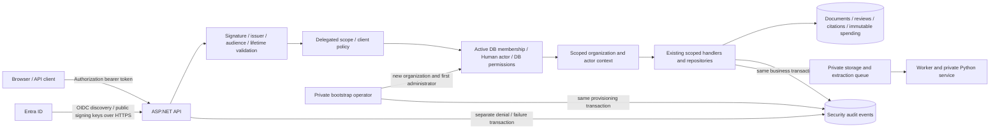

# Phase 6 threat model

September 16 acceptance review: the table below reflects the supported local
contract. The [acceptance matrix](phase-6-local-acceptance.md) separates executed
local evidence from production prerequisites. No certification is implied.

September 15 runtime update: the [reviewed runtime baseline](../design/phase-6-runtime-baseline.md)
removes reported package vulnerabilities and sets explicit .NET runtime minimums.
Known-advisory scans do not cover all native/OS or application vulnerabilities;
deployment must verify effective runtimes, image contents and future patch uptake.

September 15 update: [source-key protection](../design/phase-6-source-key-protection.md)
requires encrypted shared keys and private wrapping certificates for enterprise grants.
Missing/unsafe resources fail closed; deployment application names isolate grants.
Compromise of an identity able to read both private certificate and ring remains a
trust-boundary failure. Local tests do not prove deployed ACLs, reliable shared mounts,
certificate delivery or prompt cross-process key revocation.

Started September 11, 2026. Scope: enterprise identity, membership, audit, storage,
service authority, resource limits and local recovery. This extends
the [Phase 5 RAG threat model](phase-5-rag-threat-model.md); it does not replace
its evidence integrity, prompt screening, replay and spending controls.

The browser and all token contents are untrusted until validated. Entra signing
keys establish token authenticity; server membership establishes application
organization ownership. PostgreSQL, storage, workers and configuration are trusted
operator-controlled boundaries with separate controls and residual risks below.
The [data-access inventory](phase-6-data-access-inventory.md) traces existing
organization/actor predicates and separates trusted worker/admin paths.

| Threat | Supported local control | Residual risk / deployment work |
| --- | --- | --- |
| Anonymous document discovery | Default/fallback auth; full business-route 401 inventory | Live deployed proxy/browser verification |
| Forged/expired/wrong-resource token | Standard JWT cryptographic and lifetime validation; tenant-specific HTTPS discovery | Live signing-key rollover and outage exercise |
| Confused client or app-only credential | Allowlisted `azp`, delegated scope, v2 tenant/object claims | Entra registration and consent configuration |
| Forged tenant/actor selection | Immutable identity plus membership; signed-token read/mutation/semantic tests and worker/source binding | No tenant RLS against compromised service credentials; private operator paths remain trusted |
| Privilege escalation | Database Viewer/Reviewer/Operator roles; separate admin grant; token roles ignored; scoped/versioned browser administration; serialized last-admin protection | Live directory provisioning; stolen operator credentials |
| Stale membership | Active Human and membership lookup every request; role/revocation changes affect the next request | Atomic revocation policy for in-flight work |
| Cross-user saved answer access | Actor/source eligibility, scoped history/citations and replay; signed-token peer and foreign-organization refusal | New routes must preserve handler and repository predicates |
| Browser/proxy caching | API no-store; MSAL sessionStorage cache, PII logging disabled; sign-in/session/logout tests | Browser script compromise can expose session tokens; live browser/proxy cache verification |
| Bearer-token interception | HTTPS discovery and strict enterprise transport/configuration checks | Actual HTTPS termination, proxy policy and HSTS must be verified on the target |
| Sensitive logs or mutable audit | Safe event fields, private diagnostic suppression, atomic business audit, separate admission events, append-only trigger/restricted grants, bounded private export | Raw database logs remain sensitive; DBA tampering and host logging are outside application guarantees; private archives retain indefinitely |
| Direct file access or hostile upload | Staged scan, worker integrity/rescan, actor/membership-bound five-minute grants, certificate-protected shared keys, durable audit before release | Private filesystem ACLs/encryption, real scanner availability, deployed key sharing/TLS and privileged filesystem races |
| Worker/service impersonation | Operation-scoped expiring credentials/HTTPS; verified restricted worker grants, System actors, atomic transition audit and full lease binding | Deployed secret delivery, process separation and compromised cross-organization service authority |
| Destructive retention job | Versioned policies/holds, explicit quarantine cleanup and eligible deletion, independent journal/controls, bounded offline source verification and same-capture restore drill | Backups retain indefinitely; current independent authority required; automatic expiry and stale historical reconciliation unsupported |
| Request flooding | Process/IP/actor/organization budgets, concurrency/body caps, bounded registry and durable active-job/registered-byte capacity | Distributed/edge enforcement, physical disk quotas, measured thresholds and monitoring |
| Development mode exposure | Rejected in Production/Staging; explicit local setting | Deployment policy must also prevent mislabeling a public host as Development |

The retained Phase 5 database is read only during this work. No provider dispatch,
spend settlement, historical answer rewrite or retained migration is part of this
increment. New security schema is tested only on disposable data. Private pilot tools remain local trusted tools, not public
enterprise surfaces. Synthetic tests do not establish a security certification.

Restore detection now compares the current independent deletion journal with database deletion records and source files. Offline control-snapshot comparison detects changed or missing holds/policies. Old journal/configuration rollback and stale control exports remain trusted-operator risks; see the [deletion contract](../design/phase-6-document-deletion.md).

## API database authority (September 14)

The [restricted API profile](../design/phase-6-api-database-access.md) uses a dedicated
login and an explicit table/column allowlist. Private grant configuration and its
System audit event commit atomically. When enabled, the API verifies effective
privileges before membership lookup and returns a generic 503 on excess/missing
grants or an invalid connection. Tests exercise drift through role membership,
identity updates, audit deletion, grant options, private accounting writes, extra
relations/schemas/sequences, CREATEDB and executable SECURITY DEFINER functions.

Signed-token mutation tests now cover foreign document/job/review/field/case/run/
finding targets, saved-question actor privacy, and prepared vector/hybrid variants
under that restricted login. This reduces application mistakes and database
authority; it does not constrain allowed rows by tenant inside PostgreSQL. A stolen
service credential can still act within the allowlist across organizations. Role
owners, in-flight privilege changes, process isolation, extension capabilities and
temporary-object defaults remain operator risks. Every enterprise instance must
explicitly activate the gate and use the provisioned login. Request flooding and
resource exhaustion now have the per-process controls described below.

## Request admission and resource use (September 14)

The [request-limit contract](../design/phase-6-request-limits.md) adds bounded
process/IP admission before database access, authenticated actor/organization budgets,
and tighter limits for mutations and source downloads. Headers and raw paths cannot
create identity partitions. Memory for partitions, queued admissions (none), active
requests and body reads is bounded. Monotonic fixed windows recover without evicting
active or unexpired identities. Concurrent capacity is released on cancellation/failure.

These counters reset on restart and are not shared across replicas. A transport proxy
shares an IP bucket; forwarded headers remain untrusted. An attacker can still consume
shared capacity and cause legitimate requests to receive 429. Edge protection, workload
measurement and physical storage monitoring are needed before scaled rollout.
Throttle telemetry has bounded stage tags and no payload/identity data; it does not
write a database audit row per rejection. Existing workflow audit transactions remain.

## Durable organization capacity (September 14)

[Capacity admission](../design/phase-6-organization-capacity.md) serializes uploads and
reprocessing per organization in PostgreSQL. Active jobs and registered source bytes,
including pending deletion, survive process restart and share a policy across replicas.
Policy changes require private operator authority and commit with a System audit event;
the API has SELECT-only policy access. Enterprise profiles require a provisioned policy.

This bounds admission through the application, not arbitrary SQL or physical disk use.
Staged and orphan files, derived content and backups are excluded. A racing upload may
stage bytes before final refusal, and cleanup can fail. Physical quotas and deployment
monitoring remain open.

## Offline source recovery (September 14)

[Private recovery](../design/phase-6-orphan-recovery.md) inventories canonical unregistered
sources, preserves registrations/holds/deletion intents and executes only a bounded,
reviewed plan. Exact root/database/control binding, age/size/hash/time checks and
durable authorization audit precede removal. Completion failure is unresolved; replay
does not manufacture a success event for an already absent source.

All storage writers must remain stopped. Offline acknowledgment is a trusted operator
precondition, not process detection or an online fence. A concurrent promoted upload
could otherwise be mistaken for an orphan. Private ACLs protect the close-to-unlink
gap; privileged local races and network filesystem behavior remain outside assurance.
Schema 2 control snapshots include capacity limits and versions. Independent retention
and current capture are still required: rolling back all copies together evades detection.

## Deployment preflight (September 14)

The [readiness tool](../design/phase-6-deployment-readiness.md) has no host activation,
repair or mutation path. Input is bounded and ambiguous JSON is refused. Reports use
fixed strings instead of supplied values or exception diagnostics. Optional database
observations use exact configured restricted identities with startup read-only mode,
bounded timeouts and no pooling. Failed API grant checks prevent tenant-control reads.

A supplied configuration file is not evidence of deployed configuration. Directory
existence is not an ACL/encryption check; a current-looking control file is not proof
of freshness; catalog observations do not cover every replica. DeploymentVerified
always remains false. Live TLS/identity/scanner behavior, secret delivery, protected
key sharing, recovery and operational evidence still require target-environment checks.
